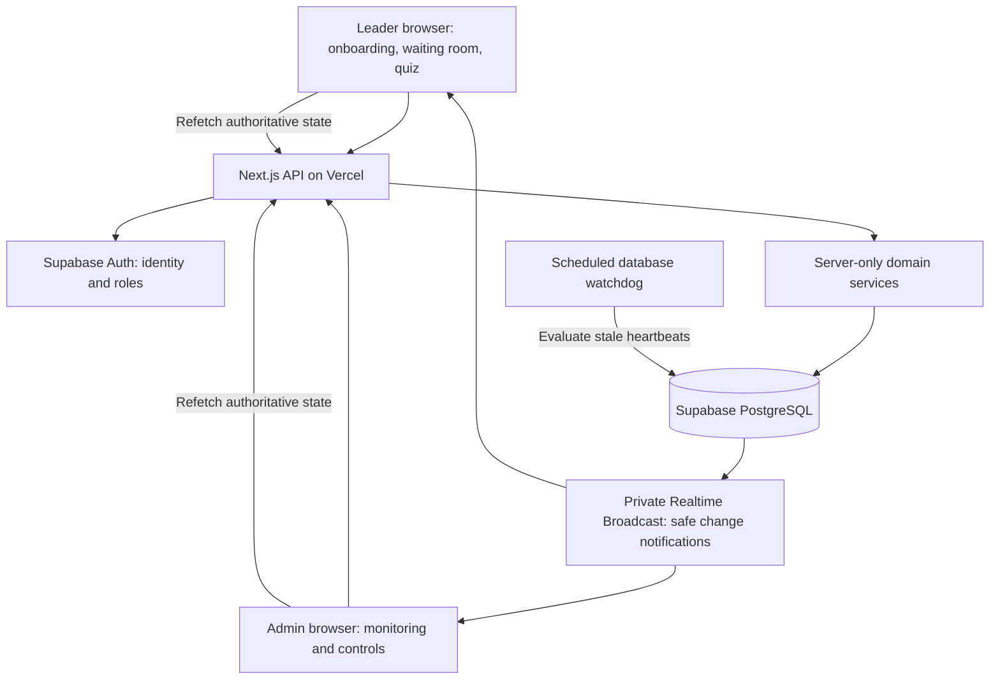
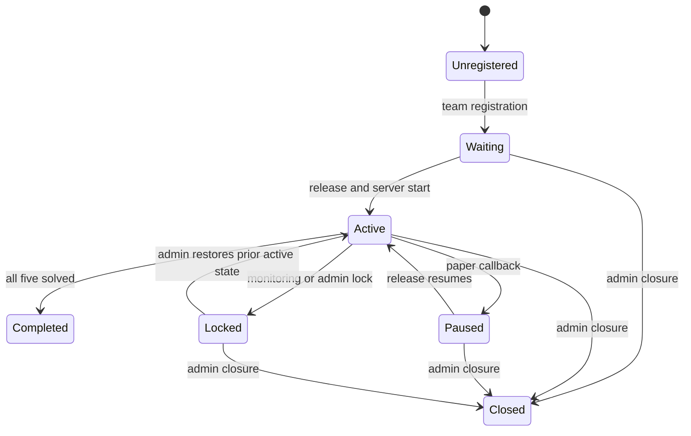

# Architecture and component boundaries

> Original approved design. For the implemented stack and operational behavior, see [implementation.md](implementation.md); signed JWT sessions and SSE replace the initially proposed Supabase Auth/Broadcast integration.

## Integration map

The browser renders state and sends intent. The server identifies the caller, authorizes the action and validates inputs. PostgreSQL commits the complete change. Only then does a notification prompt clients to reload their permitted state. Realtime messages never authorize an action or carry answer keys.

## Components and connections

| Component | Owns | Calls / persists |
| --- | --- | --- |
| Authentication | Verified leader identity, registration lookup, session and admin role checks | Supabase Auth, profiles, student registry |
| Team registration | 1–5 members, exactly one matching leader, unique membership, 12 numbered teams | One database transaction covering registry, members and slot allocation |
| Waiting room | Release and lock status, reconnect handling | Status API plus private notifications |
| Release service | Global release/callback, random set allocation, explicit starts | Quiz control row and attempt rows in one transaction |
| Quiz engine | Module selection, answer comparison, score finalization | Server-only paper repository, attempt and question progress rows |
| Hint service | 300-second eligibility, ordered delivery, one charge per hint | Attempt row lock and unique hint receipt |
| Monitoring | 3-second heartbeat, active module, browser event reporting | Heartbeat and event endpoints, server timestamps, watchdog |
| Admin service | Live view, set overrides, locks, closure, restore and reissue | Role-checked commands with before/after audit records |
| Completion | Five solved questions, itemized score, 60-second completion view | Atomic finalization and durable completion timestamp |

## Durable data model

Extend the example schema from Prompt.md rather than applying it unchanged.

| Entity | Important constraints / reason |
| --- | --- |
| `profiles` | Auth UUID primary key; server-controlled role. Admin username is an identifier, not permission. |
| `student_registry` | Canonical unique registration number, normalized consistently; identity binding prevents leader/member duplication across separate tables. |
| `teams`, `team_members` | Team number unique and 1–12; unique leader and student membership; transactional enforcement of member count and exactly one leader. |
| `team_slots` | Precreated numbers 1–12; locked slot allocation prevents concurrent oversubscription. A sequence alone does not safely allocate reusable bounded slots. |
| `quiz_control` | Singleton release state, closure state, revision and actor; missing from source schema. |
| `paper_versions`, `questions` | Three validated sets, five unique modules per set, 2 marks per question; immutable published version per attempt. |
| `private.answer_keys`, `private.hints` | Outside exposed Data API schemas; no browser grants. Only server transactions may evaluate/deliver them. |
| `quiz_attempts` | Team, paper version, start/end, active module, state, version, lock reason and previous state; at most one current attempt per team. |
| `question_progress` | Unique attempt/question, solved state, attempt count, final submitted key, exact decimal marks and deductions. |
| `hint_receipts` | Unique attempt/question/hint; records disclosed text version and charge; repeat requests return the same receipt without another deduction. |
| `answer_events` | Answer attempts, request ID and outcome; protected from students and redacted from general logs. |
| `heartbeats`, `proctoring_events` | Server receipt time, session binding, sequence number, reported signal and lock decision. |
| `admin_audit` | Actor, target, command, reason, before/after state and timestamp. |

Store exact decimal scores or integer subunits, never floating-point arithmetic. Aggregate totals from committed per-question records. Proposed floor: zero marks per question; this needs confirmation against the final marking scheme.

## State and time

Locks are an overlay with a saved prior state, so unlocking can restore Waiting or Paused as well as Active. Closure and completion are terminal for the current attempt. An audited admin reissue creates a new attempt and preserves the old one.

Timing rule update: every assigned set has a total limit of 40 minutes from its server-recorded start. Release assigns and starts all eligible waiting teams; reconnect never resets the deadline. Callback and lockouts pause interaction but keep the exam clock running. Hints become available at `server_now >= started_at + 300 seconds`. At `server_now >= started_at + 2400 seconds`, the server finalizes earned marks and blocks further quiz actions. The completion view expires at `completed_at + 60 seconds`.

## Security boundaries

- All mutation endpoints resolve the team from the session, then check attempt state, release status, lock, paper version and question ownership. Never trust a submitted team ID for student authorization.
- Use secure HTTP-only cookies, HTTPS, same-site controls, origin/CSRF validation for mutations, request limits and database-backed throttling. Do not expose service credentials in browser environment variables.
- Private realtime channels use short-lived, narrowly scoped authorization. Teams only subscribe to their own change notifications; admins receive an explicitly authorized monitoring channel. On reconnect, refetch state and reconcile its revision.
- Deny direct browser access to private papers, keys, unreleased hints, answer history and admin audit data. RLS protects exposed rows; DTO allowlists prevent secret columns from entering responses.
- A guessed whole-number answer remains possible. Bound answer frequency and audit retries; hashing small numeric keys alone does not protect against offline guessing.
- Use TLS for heartbeat transport. Browser-provided encryption or event claims cannot prove that a student stayed focused. Never log cookies, tokens or answer secrets in application telemetry.
